<p align="center"></p>

# Bible Bluff

## BibleBluff Kids – Die große Bluff-Jagd

Über das Kids-Logo oben links auf der Startseite oder direkt unter `/kids` erreichbar.
Die ca. 45-minütige Beamer-Show ersetzt das bisherige kurze Kids-Spiel. Glühwürmchen (3–5),
Leuchtsterne (6–8) und Fackelträger (9–11) spielen gemeinsam gegen den liebenswerten Professor Bluff.
Die Namen erscheinen immer mit ihrem festen Symbol: Glühwürmchen, Stern und Fackel.
Pro Kapitel kommt jede Altersgruppe einmal dran: neun Aufgaben aus dem bestehenden
Fragenpool und ein gemeinsamer Superbluff. Für Glühwürmchen gibt es animierte Bilder und kurze,
lokal erzeugte Klangbilder; Eltern und andere Gruppen machen Geräusche und Pantomime.

- Drei nummerierte Felder im Raum, 30 Sekunden nach dem Vorlesen. Andere Gruppen bleiben
  in ihren Bereichen. Eltern dürfen Glühwürmchen begleiten. Keine Kinderkonten oder Einzelwertung.
- Nach Stopp prüfen Helfer die Antwortfelder. **Zurück in die Gruppen → Alle sind zurück**
  zeigt Professor Bluff groß und animiert; erst danach wird die Wertung freigeschaltet. Nur das gemeinsame Resultat wird erfasst.
- Kinderteam: Mehrheit richtig = 10 Punkte; sonst mindestens ein Kind richtig = 5; keiner richtig = 0. Maximal 30 je Altersgruppe.
  Professor: +7 je gewerteter regulärer Aufgabe (in der Kurzshow +6). Keine heimliche Anpassung der Wertung.
- Superbluff: Kinder erhalten 20 / 10 / 0 Punkte (Mehrheit / mindestens ein Kind / niemand richtig).
  Professor erhält im Finale keine neuen Punkte. So lässt sich ein Rückstand von weniger als 20 Punkten noch aufholen. Endstand erst nach
  dem Finale. Die Spielleitung kann auch jederzeit früher mit dem erreichten Punktestand abschließen.
  Der Abschluss feiert alle Kinder mit Jesu Einladung (Markus 10,14).
- **Kurzshow · 15 Minuten** hat in der Vorbereitung einen eigenen Startknopf: Begrüßung, ein Kapitel
  (je eine Aufgabe für Glühwürmchen, Leuchtsterne und Fackelträger), Superbluff und Abschluss. 20 statt
  30 Sekunden. Die Kinder bleiben sitzen und zeigen 1, 2 oder 3 Finger; nach dem Stopp wird sofort gewertet,
  ohne die Bildschirme „Zurück in die Gruppen“ und „Alle sind zurück“. Punkte und Professor wie in der
  vollen Show, nur bekommt Professor Bluff +6 statt +7 je Aufgabe (Kinder bis 50, Professor 18). „Bedienung“ und das Smartphone zeigen einen Zeitplan ab
  „Mission starten“ (Aufgaben bis 2:30, 5:00, 7:30, Superbluff bis 11:30, Abschluss bis 13:30; plus
  1:30 Begrüßung) und melden, ob ihr im Plan liegt. Fernbedienung, Sicherung und „Show fortsetzen“
  funktionieren auch hier.
- **Direkt ins Finale** springt jederzeit sofort zum Superbluff: am Beamer oben über „Finale“
  oder im Bedienmenü, auf dem Smartphone direkt unter dem Punktestand. Gewertete Aufgaben
  bleiben erhalten; übersprungene Aufgaben zählen für beide Seiten nicht. Laufender Ton,
  Szenen und Countdown stoppen, die Finalrunde startet danach wie gewohnt manuell.
- **Professor Bluff blufft in jeder Aufgabe:** Er behauptet selbstbewusst eine falsche Antwort.
  Seine Behauptung steht unten am Beamer, ein kleiner Professor-Kopf mit „?“ markiert sein Feld.
  Die Kinder entlarven ihn. Für die Behauptung gibt es keine Aufnahme; die Spielleitung liest sie
  mit Professor-Stimme vor (sie steht auch auf dem Smartphone, ihr Feld ist dort markiert).
- **Trommelwirbel vor der Auflösung:** Nach der Wertung wackeln die drei Felder, die falschen
  bekommen nacheinander den Stempel „BLUFF!“ (Professor Bluffs Tipp zuletzt), dann leuchtet die
  Wahrheit. Erst danach erscheinen Punkte, Konfetti und Professor-Reaktion. „Weiter“ bleibt
  erreichbar. Kein Trommelwirbel nach Neuladen, bei Korrekturen oder bei „Bewegung reduzieren“.
- **Countdown zum Mitzählen:** In den letzten fünf Sekunden erscheint eine große Zahl und
  „Zählt laut mit!“. Mit Klang ticken die Sekunden, bei null ertönt ein Gong. Der Klang wird
  auch beim ersten Start der 30 Sekunden am Beamer eingeschaltet.
- **Leuchtende Gruppensymbole:** Jede Gruppe hat drei Leuchtpunkte (voll = 10, halb = 5). Ihr
  Symbol leuchtet mit jeder Wertung stärker und pulsiert, wenn es gerade Punkte gab. Das
  Punkterennen ist größer; zieht das Kinderteam an Professor Bluff vorbei, zeigt es „Überholt!“
  (mit Klang).
- **Mitmach-Gesten:** Während eine Gruppe läuft, zeigt der Beamer den anderen ihre feste Geste:
  ✨ Glühwürmchen funkeln, 🥁 Leuchtsterne trommeln, 🤞 Fackelträger drücken die Daumen.
- Professor mit spielstandsabhängigen Kommentaren. Jede Auflösung hat eine eigene Showbühne:
  bei 5 oder 10 Punkten erschrickt er mit einem neuen Spruch, bei 0 Punkten macht er Mut.
  Die richtige Antwort und die Erklärung bleiben dabei sichtbar. Die Animation wartet auf
  die Spielleitung; reduzierte Bewegung wird berücksichtigt.
- Große Professor-Szenen haben eigene Choreografien: Begrüßungswinken, Schrecksprung mit
  hochgerissenen Armen und hüpfender Brille, schwungvolle Drehung, Stolpern, ungläubiges
  Hin-und-her-Schauen, ermutigende Gesten, Heranwinken, Nachdenken, nervöses Trippeln und
  eine Verbeugung mit Abschiedswinken. Die positiven Auflösungen wechseln ihre Bewegungen;
  bei null Punkten bleibt der Professor ermutigend. Die Animationen laufen begrenzt und
  bleiben innerhalb der Figurfläche; „Bewegung reduzieren“ schaltet sie vollständig ab.
- Die Kinderanzeige startet ohne Bedienknöpfe, Abspielbuttons oder Technikhinweise. Das gilt auch
  beim Neuladen, bei Mausbewegungen, in der Auflösung und auf kleinen Displays.
  **H** blendet am Computer die Mausbedienung ein und aus. Vor dem Einlass lässt sich über
  **Smartphone-Fernbedienung einrichten** direkt eine Show mit QR-Code vorbereiten.
- Vollbild in der Vorbereitung oder nach **H** über **Vollbild** in der Kopfzeile. Größere Figuren, farbige Punktekarten
  und eine klare Aufteilung für Frage, Auflösung und Professor auf der Leinwand.
- Mausbedienung über **H** ein-/ausblenden. Leertaste oder Pfeil rechts: weiter;
  P: Pause/fortsetzen; H: Mausknöpfe. Während der Wertung: 1 = Mehrheit richtig,
  2 = mindestens ein Kind richtig, 0 = keiner richtig.
- Smartphone der Spielleitung: direkt in der Vorbereitung oder **H → Bedienung → Smartphone verbinden**, QR-Code scannen.
  Start, Pause, Rückweg, Mehrheitswertung, Szene und Abschluss steuern denselben
  Stand wie die Maus. Regiehinweise bleiben auf der Fernbedienung. Klang am Beamer aktivieren.
- Die Fernbedienung hat drei Reiter: **Ablauf** mit nächster Aktion, passenden Audios und aufklappbaren
  Antworten/Regiehinweisen; **Zusatzaudios** mit Kategorien und einer Suche über alle Ansagen;
  **Funktionen** mit Finalsprung, Abschluss, Wertungskorrektur und Technikhinweisen.
  Die Stopptaste für Professor-Audios bleibt in allen drei Bereichen erreichbar. Neue Spielphasen
  bringen im Ablauf die nächste Aktion wieder nach oben. Richtige Antworten sind nur für Helfer markiert.
- **Letzte Wertung ändern** unter **Funktionen** korrigiert die zuletzt abgeschlossene Aufgabe
  auf 10 / 5 / 0 Punkte (im Finale 20 / 10 / 0), auch nach dem Weitergehen oder am Endbildschirm. Aktuelle Frage,
  Countdown und Professor-Punkte bleiben bestehen; es wird keine Runde erneut gezählt.
- **Zwischendurch-Sprüche** bietet 23 manuell abspielbare Professor-Ansagen in den Bereichen
  Mitmachen, Ablauf, Spannung, Mut machen, Gruppenaufrufe und Spielsignale. Alle Aufnahmen verwenden die bisherige Snorre-Stimme,
  erklingen am Beamer und lassen sich stoppen oder durch einen anderen Spruch ersetzen.
- **Passende Phasenansagen** stehen direkt beim aktuellen Spielschritt: der Aufruf der aktiven
  Altersgruppe vor der Frage, Countdown/Anfeuern während der Antwortwahl, Pause, Stopp,
  „Alle sind zurück“ vor der Auflösung und der Gedanke „Bei Jesus sind wir willkommen“ am Abschluss.
  **Countdown für letzte 5 Sekunden vormerken** lässt Professor Bluff synchron zum laufenden Timer
  fünf bis eins zählen. Pause, ein anderes Audio und Phasenwechsel heben die Vormerkung auf.
  Es gibt keine automatische Sprachausgabe beim Aufrufen, Neuladen oder Wechseln der Spielphase.
- **Frage vorlesen** liest auf manuellen Klick die sichtbare Frage mit Professor Bluffs Stimme.
  Auch über **Frage am Beamer vorlesen** auf dem Smartphone steuerbar; die 30 Sekunden
  starten weiterhin separat. Stoppen, Wiederholen und Abbruch beim Weitergehen sind möglich.
  Die neun regulären Fragen haben eigene MP3-Aufnahmen. Für die noch fehlende Finalaufnahme
  wird vorläufig eine deutsche Gerätestimme genutzt; fehlt diese, erscheint ein Hinweis zum Vorlesen.
- Befristete Links mit getrennten Zugriffsschlüsseln, Hashes in D1 und versionierten
  Spielzügen gegen Doppelklicks. Wiederverbindung nach Neuladen und Netzabbruch.
  Ohne Smartphone-Verbindung läuft die Show lokal ohne Serverzugriff.
- **Neuladen kostet nichts:** Der Beamer-Rechner sichert jeden Spielstand (`localStorage`, bis zu 6 Stunden).
  Nach versehentlichem Neuladen oder einem Absturz bietet die Vorbereitung **Show fortsetzen?** mit Kapitel,
  Gruppe und Punkten an. Der Knopf hat den Fokus, die Leertaste genügt. Ein laufender Countdown ist danach
  angehalten, eine Szene beendet, der Professor schweigt. **Verwerfen** oder **Zur Vorbereitung** am Ende löschen den Stand.
- **Netzausfall:** **Show vorbereiten** lädt alle Professor-Aufnahmen vorab in den Speicher. Fällt das Internet
  aus, spricht der Professor weiter. Über https legt die Show zusätzlich eine Offline-Kopie an (Service Worker
  `kids-sw.js`, nur für `/kids`, immer zuerst das Netz). Dann lädt die Seite auch ganz ohne Internet neu.
  Bricht die Verbindung zur Smartphone-Fernbedienung ab, geht es mit **Ohne Smartphone weiterspielen** per Maus
  und Tastatur weiter.
- **Technik-Check** in der Vorbereitung: spielt einen Testsatz über die Lautsprecher und zeigt Ton, geladene
  Aufnahmen, Offline-Kopie, Internet für die Fernbedienung und Vollbild. Aufnahmen und Offline-Kopie stehen
  auch im Bedienmenü.
- Moderation, Beamer-Bedienung, Gruppenhelfer und genügend Platz inklusive begleitender
  Eltern einplanen. Helferplan und Ablauf stehen in der Vorbereitung.

**Erfinde Bluffs. Finde die Wahrheit. Entdecke die Bibel.**

Bible Bluff ist ein Partyspiel für den Browser: Jede Person spielt auf dem eigenen Handy, ein Fernseher oder Beamer kann zusätzlich die gemeinsame Ansicht zeigen. Alle sehen dieselbe Bibelfrage und erfinden heimlich eine glaubwürdige, aber falsche Antwort. Danach steht die echte Antwort anonym zwischen den Bluffs, und alle tippen auf die vermeintlich richtige. Bei der Aufdeckung zeigt sich, wer worauf hereingefallen ist und was wirklich stimmt.

Die Fragen stammen aus dem *Studienkonzept NT* (Lernblätter zu allen 27 Büchern des Neuen Testaments, freikirchlich-pfingstliche Lernfassung). Dazu kommen geprüfte Fragen aus einem eigenen Fragenpool, auch zu ausgewählten Geschichten des Alten Testaments. Hinzu kommen die in der Fragenwerkstatt freigegebenen Fragen, darunter 30 zu Jesu Botschaft. Der Pool umfasst 186 kuratierte Fragen und 45 Lückentexte, jeweils mit Bibelstelle und einer kurzen Entdeckung. Auf Englisch gibt es eine erste Fassung mit 88 ausgewählten Fragen und Lückentexten – umschalten lässt sie sich mit der Flagge auf der Startseite (siehe [Englische Fassung](#englische-fassung)).

| Start | Lobby | Bluff schreiben | Abstimmen |
| --- | --- | --- | --- |
| 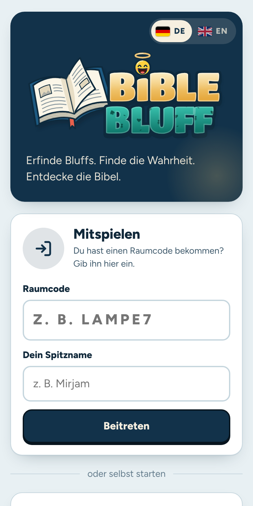 | 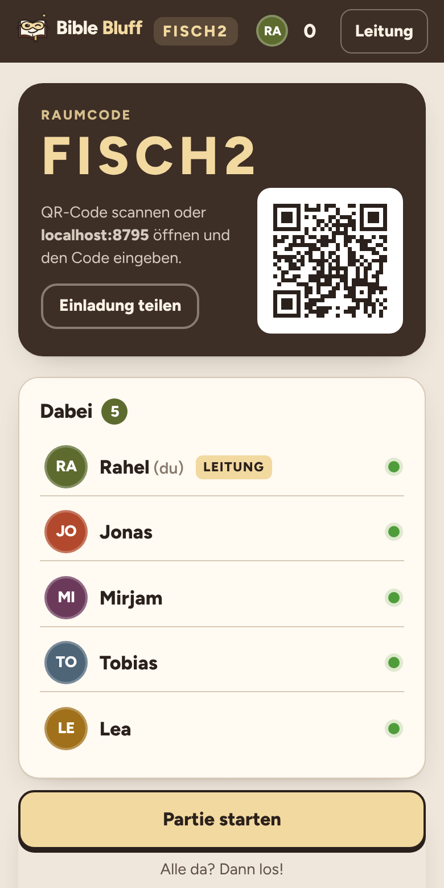 | 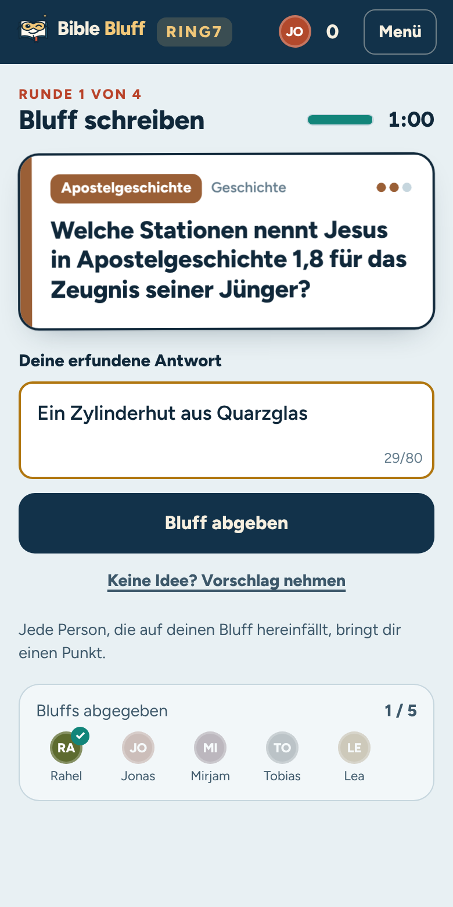 | 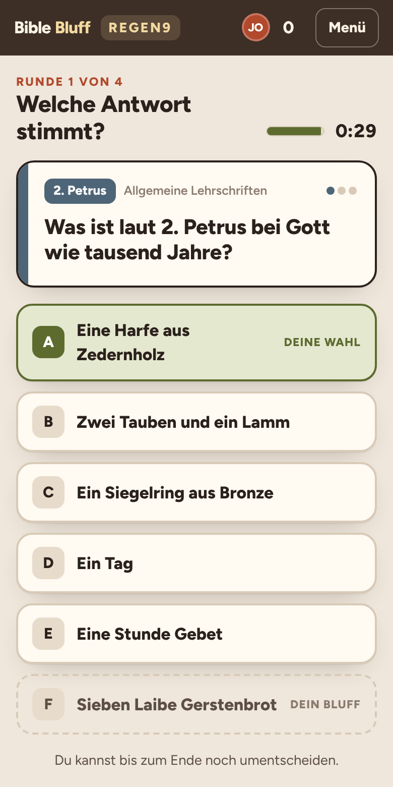 |

| Aufdeckung: Bluff | Aufdeckung: Wahrheit | Punkte & Entdeckung | Endstand |
| --- | --- | --- | --- |
|  | 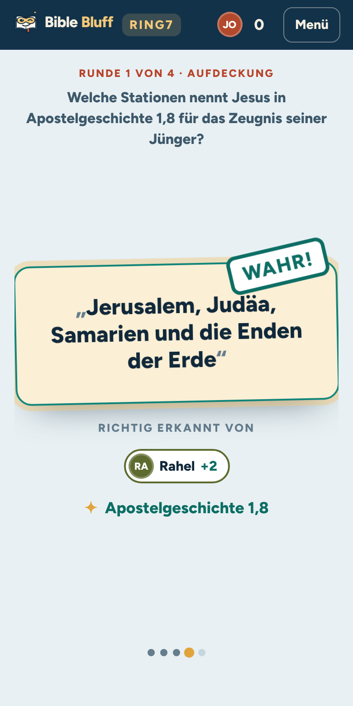 | 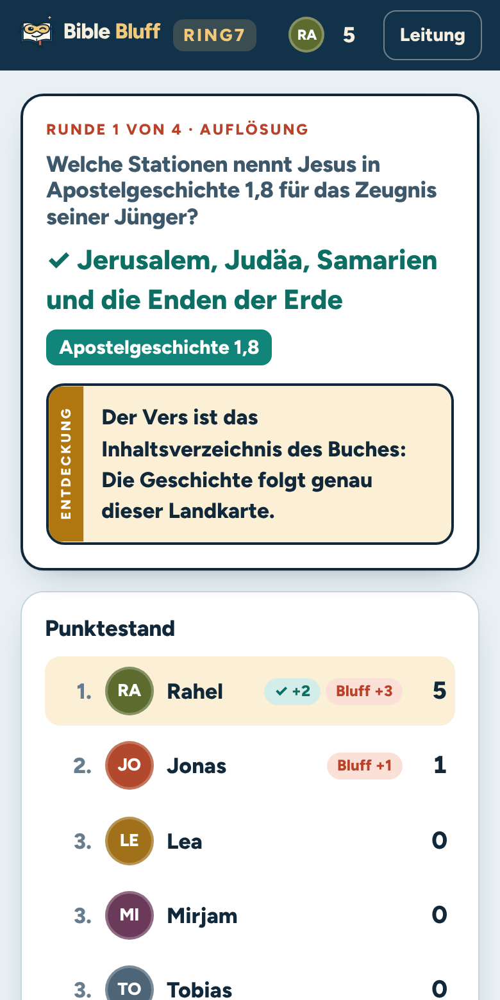 | 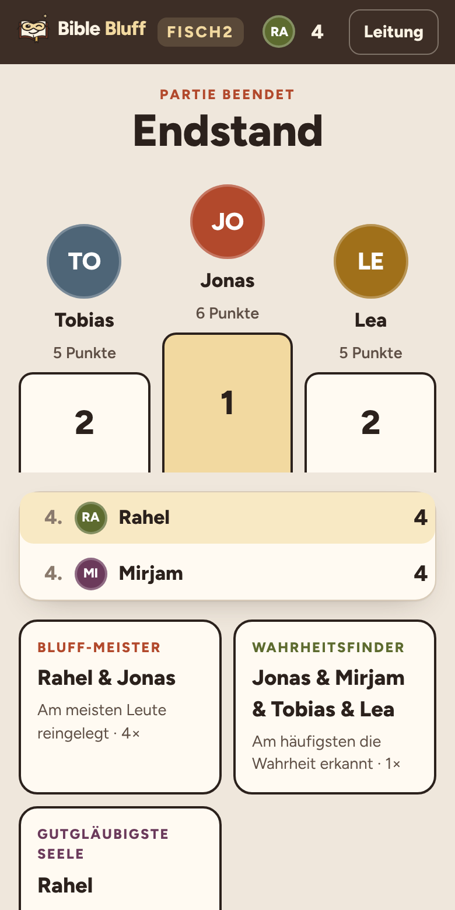 |

| Lieblingsbluff | Bester Bluff des Abends | Entdeckungen teilen | Entdeckungen zum Mitnehmen |
| --- | --- | --- | --- |
| 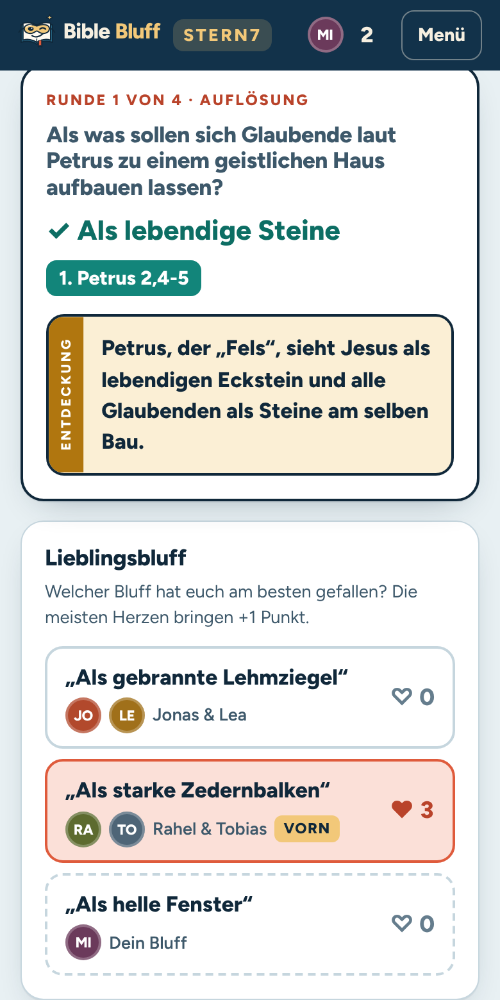 | 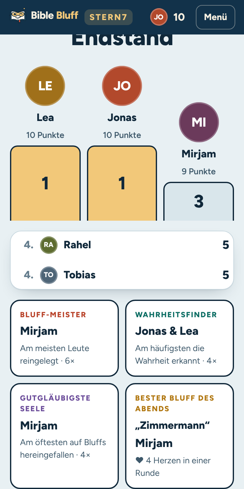 | 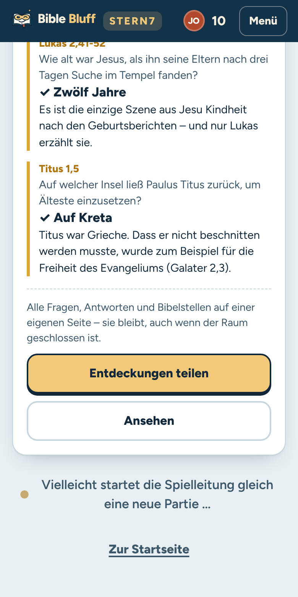 | 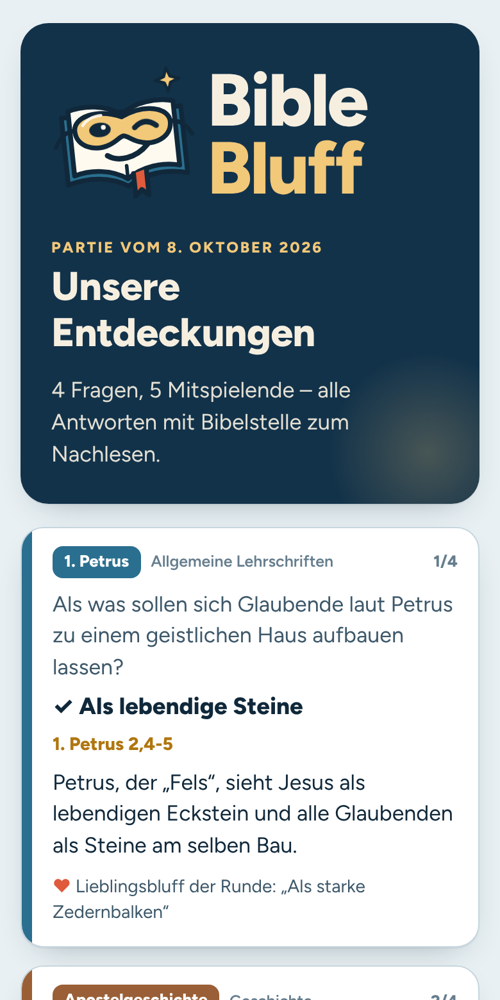 |

| Spickzettel der Leitung | Vom Spiel ins Gespräch | Liebe deinen Nächsten | Ruhige Minute |
| --- | --- | --- | --- |
| 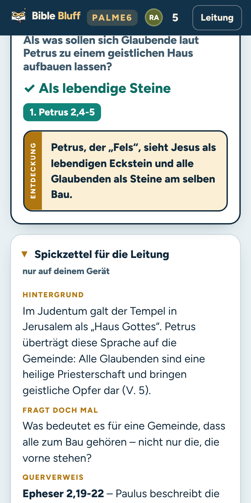 | 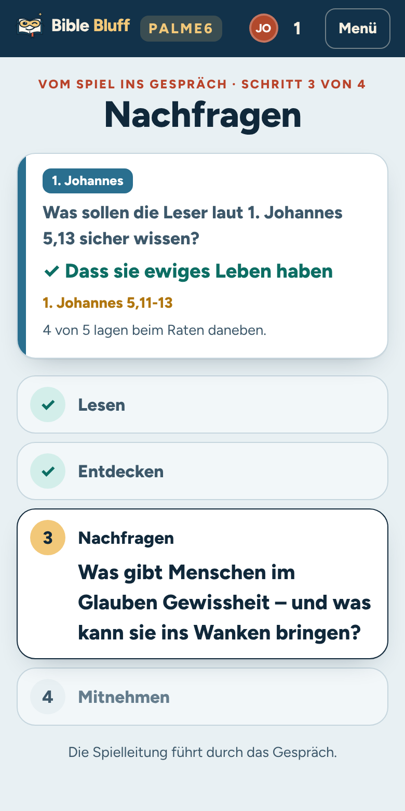 | 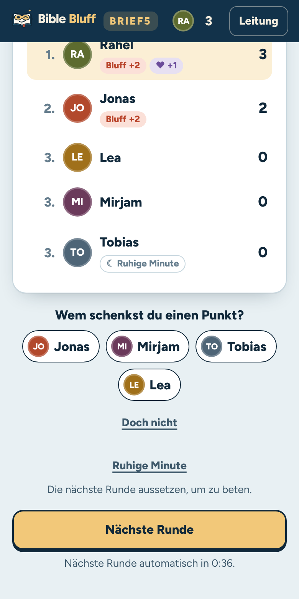 | 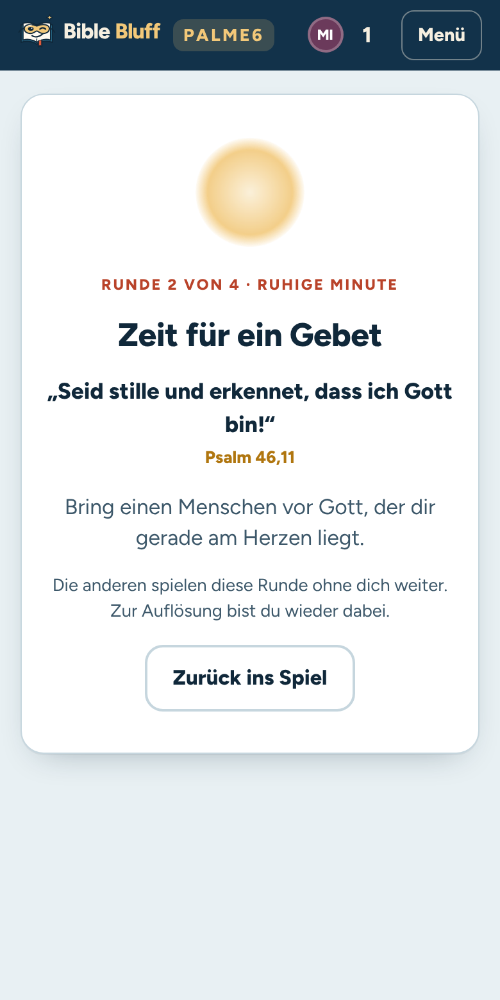 |

Leinwand-Ansicht (`/tv/RAUMCODE`):

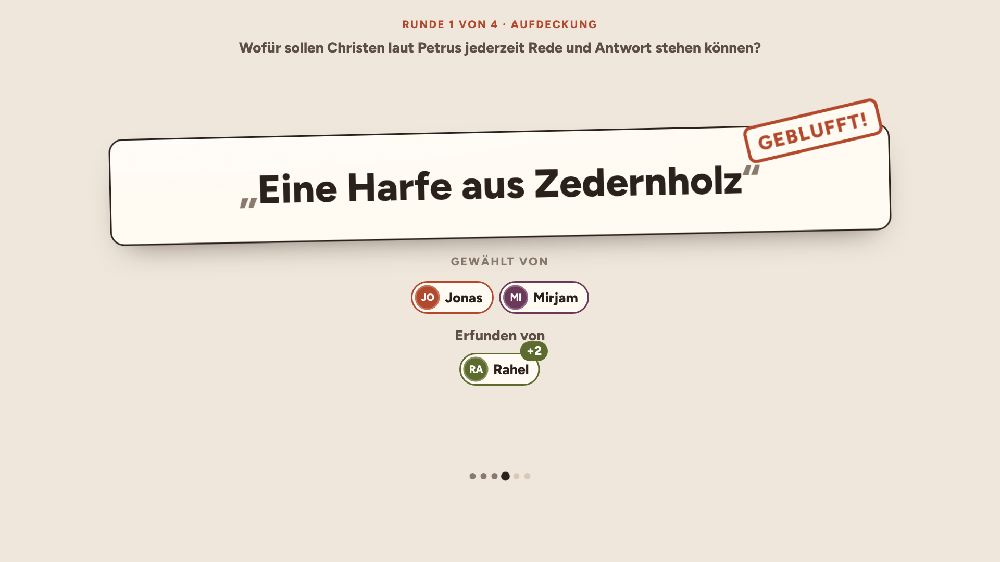

## So läuft eine Partie

1. **Raum eröffnen.** Die Spielleitung wählt Rundenzahl (4–12, Standard 8), Rundenart (Fragen, Lückentext oder gemischt), Kategorien, Schwierigkeit (leicht, mittel, schwer, gemischt) und die Zeitlimits. Sie spielt mit oder leitet nur, etwa am Beamer.
2. **Beitreten.** Alle scannen den QR-Code oder geben den Raumcode (z. B. `LAMPE7`) und einen Spitznamen ein. Konten gibt es nicht.
3. **Gemeinsam starten.** Dieselbe Runde beginnt auf allen Handys.

| Phase | Was passiert |
| --- | --- |
| Bluff schreiben (45–120 s) | Alle erfinden heimlich eine falsche Antwort. Wer keine Idee hat, nimmt einen vorbereiteten Vorschlag, einen pro Runde. |
| Abstimmen (20–60 s) | Die Wahrheit steht anonym und gemischt zwischen den Bluffs. Den eigenen Bluff kann man nicht wählen. |
| Aufdecken | Synchron auf allen Geräten: Wer hat was gewählt? Wer hat es erfunden? Am Ende kommt der Stempel „Wahr!“. |
| Punkte & Entdeckung | Die Bibelstelle, ein überraschender Satz zur Auflösung und der Punktestand. Alle verteilen ein Herz an ihren Lieblingsbluff, und wer mag, verschenkt einen Punkt. |

**Punkte:** +2 für das Erkennen der richtigen Antwort, +1 für jede Person, die auf den eigenen Bluff hereinfällt, +1 für den Lieblingsbluff der Runde.

Dadurch kann auch jemand mit wenig Bibelwissen gewinnen, denn gute Einfälle und Menschenkenntnis zählen mit. Am Ende gibt es ein Siegertreppchen und fünf Auszeichnungen (Bluff-Meister, Wahrheitsfinder, Gutgläubigste Seele, Bester Bluff des Abends, Nächstenliebe). Außerdem zeigt der Endstand alle Entdeckungen der Partie zum Nachlesen, und die Leitung kann direkt ins Gespräch überleiten.

### Anleitung auf der Startseite

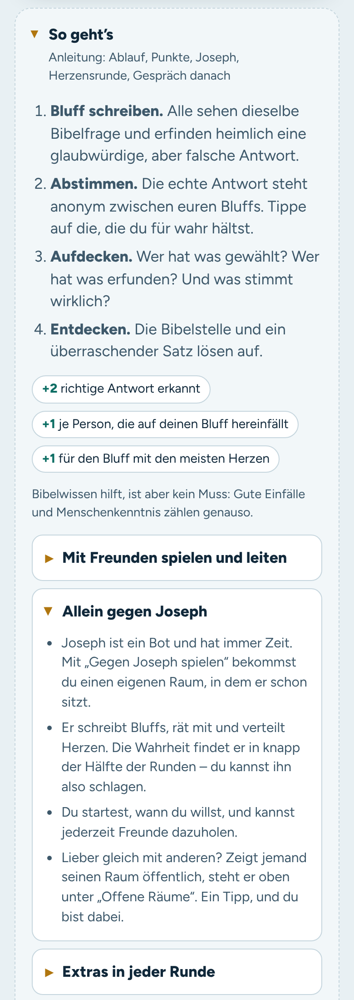

„So geht’s“ steht auf der Startseite zugeklappt, damit sie kurz bleibt; die Zeile nennt, was drinsteht. Aufgeklappt zeigt die Anleitung oben Ablauf und Punkte, darunter Themen, die sich einzeln aufklappen lassen:

- **Mit Freunden spielen und leiten:** Raum eröffnen, Beitreten, Leinwand, Menü „Leitung“, Wiedereinstieg mit demselben Spitznamen
- **Allein gegen Jakob:** was der Bot kann und wie man stattdessen einem offenen Raum beitritt
- **Extras in jeder Runde:** Vorschlag, „zu nah an der Wahrheit“, Lieblingsbluff, Liebe deinen Nächsten, Ruhige Minute
- **Herzensrunde:** Ablauf, Anonymität und wer sie ein- und ausschaltet
- **Nachbesprechung:** Spickzettel der Leitung und „Weiter ins Gespräch“ mit seinen vier Schritten
- **Nach der Partie:** Auszeichnungen, Entdeckungen, Mein Vers für die Woche und ein Link zu `/jesus`

Die Anleitung und die kurzen Regeln „So geht’s“ beim Beitreten, im Warteraum und im Menü nutzen dieselben Bausteine (`RuleSteps`, `Points` in `src/client/components/ui.tsx`); die Themen stehen in `src/client/components/Guide.tsx`. Auch die Farbauswahl ist auf der Startseite zugeklappt und zeigt in der Zeile das gewählte Farbkonzept.

<br clear="right">

### Lückentext

Statt einer Frage steht ein Satz zu einer Bibelstelle mit einer Lücke da, zum Beispiel: „Simson erschlug tausend Philister mit ___.“ Alle erfinden, was in die Lücke gehört; die Wahrheit steht wie gewohnt anonym zwischen den Bluffs. Beim Aufdecken erscheint jede Antwort eingesetzt im Satz – das sorgt für eigene Lacher.

- **Rundenart:** *Fragen* (wie bisher), *Lückentext* (nur Lückentexte) oder *Gemischt* (Standard): Dann ist etwa jede dritte Runde ein Lückentext, gleichmäßig verteilt und nie gleich in der ersten Runde.
- **Schreibweise:** Mitten im Satz beginnen Artikel, Zahlen und Präpositionen klein („einem Ochsenstachel“), auch wenn das Handy sie großgeschrieben hat. Wer den ganzen Satz abtippt, bekommt nur den Teil für die Lücke. Beim Abstimmen beginnen alle Antworten groß, damit die Schreibweise nichts verrät.
- Die 45 Lückentexte stehen in `src/server/lueckentext.ts`, mit eigenen Worten formuliert, samt Hausbluffs und Spickzettel.

### Kategorien

Die Spielleitung wählt beim Eröffnen oder in der Lobby eine oder mehrere Kategorien: *Evangelien*, *Apostelgeschichte*, *Paulusbriefe* (mit den Briefen an Timotheus und Titus), *Weitere Briefe* (Hebräer bis Judas), *Offenbarung* und *Altes Testament*. Jede Kategorie zeigt, wie viele Fragen beziehungsweise Lückentexte sie zur gewählten Rundenart hat (`GET /api/pool`). Reicht die Auswahl nicht für alle Runden, sagt die App das vorher, und die Partie wird entsprechend kürzer. „Neues für alle“ zählt nur Fragen aus der Auswahl.

### Lieblingsbluff

Nach der Auflösung zeigt jedes Handy die Bluffs der Runde mit ihren Urhebern. Jede Person verteilt ein Herz an den Bluff, der ihr am besten gefallen hat. Nochmal tippen nimmt das Herz zurück, ein anderer Bluff bekommt es stattdessen. Für den eigenen Bluff gibt es kein Herz. Der Bluff mit den meisten Herzen bringt seinen Urhebern +1 Punkt, bei Gleichstand allen führenden. Der Punkt erscheint sofort im Punktestand und wird beim Weiterschalten gutgeschrieben. Im Endstand kürt das Spiel den **Besten Bluff des Abends**: den Bluff mit den meisten Herzen in einer Runde, im Wortlaut.

### Entdeckungen zum Mitnehmen

Nach der letzten Runde legt das Spiel eine dauerhafte Seite unter `/e/ID` an. Sie zeigt alle Fragen der Partie mit Antwort, Bibelstelle, Entdeckung und dem Lieblingsbluff jeder Runde. Auf den Handys steht im Endstand „Entdeckungen teilen“ (Teilen-Dialog oder Link kopieren), die Leinwand zeigt oben rechts einen QR-Code. Die Seite enthält keine Namen und keinen Raumcode. Sie bleibt erhalten, auch wenn der Raum längst gelöscht ist, und eignet sich zum Nachlesen in der Woche oder für die nächste Kleingruppe.

### Liebe deinen Nächsten

In der Punkte-Phase verschenkt jede Person einmal pro Runde einen eigenen Punkt an jemanden, den sie auswählt. Der Punktestand zeigt das sofort („+1 von Rahel“, „−1 an Mirjam“), und wer beschenkt wird, bekommt einen Hinweis aufs Handy. Verschenken lässt sich nur, was man schon hat; der vorläufige Lieblingsbluff-Punkt zählt erst nach dem Weiterschalten. Wer am meisten verschenkt hat, bekommt im Endstand die Auszeichnung **Nächstenliebe**.

### Ruhige Minute

Wer eine Pause zum Beten braucht, tippt auf „Ruhige Minute“. Beim Schreiben oder Abstimmen setzt die Person die laufende Runde aus, nach der Auflösung die nächste. Das Spiel wartet nicht auf sie, ein schon geschriebener Bluff oder eine Stimme wird zurückgenommen. Ihr Handy zeigt stattdessen eine ruhige Seite mit einem Psalmvers und einem kurzen Gebetsimpuls; die anderen sehen nur ein ☾ neben dem Namen. „Zurück ins Spiel“ geht jederzeit, spätestens zur nächsten Runde ist sie automatisch wieder dabei.

### Vom Spiel ins Gespräch

Zu jeder Frage und jedem Lückentext gibt es einen **Spickzettel** mit Hintergrundwissen, einer offenen Gesprächsfrage und einem Querverweis auf eine andere Bibelstelle. Er erscheint nach jeder Auflösung nur auf dem Gerät der Spielleitung (am Beamer zunächst zugeklappt).

Nach dem Endstand führt „Weiter ins Gespräch“ zu der Frage, bei der die meisten danebenlagen; jede andere Frage der Partie lässt sich ebenso wählen. Die Leitung blättert durch vier Schritte, und alle Handys und die Leinwand gehen mit:

1. **Lesen:** die Bibelstelle aufschlagen und laut vorlesen.
2. **Entdecken:** Was fällt auf, was hat überrascht? Dazu der Hintergrund vom Spickzettel.
3. **Nachfragen:** die Gesprächsfrage zur Stelle.
4. **Mitnehmen:** Was nehmen wir mit, wofür danken oder beten wir? Dazu der Querverweis zum Weiterlesen.

So wird aus einem Spieleabend ein Hauskreis-Abend ohne Vorbereitung. Das Gespräch ist freiwillig: „Zurück zum Endstand“ beendet es jederzeit. Die Texte (`src/server/talk.ts`) sind mit KI-Hilfe geschrieben und gegengeprüft; Querverweise sind mit eigenen Worten wiedergegeben, ohne geschützte Bibelübersetzungen zu zitieren. Eine Durchsicht durch jemanden aus eurer Gemeinde lohnt sich trotzdem.

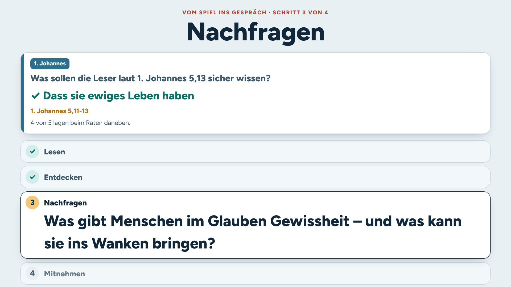

### Herzensrunde

Zum Schluss eine Runde ohne Punkte und ohne Bluffen: Alle schreiben ehrlich eine Antwort auf eine von fünf Fragen, zum Beispiel „Was hat dich heute an Jesus überrascht?“ oder „Was würdest du Jesus gern fragen?“. Die Fragen passen auch für Gäste, die mit dem Glauben (noch) wenig anfangen können. „Diesmal nicht“ geht immer. Sobald alle fertig sind (oder nach zwei Minuten), erscheinen die Antworten nacheinander auf allen Handys und der Leinwand, gemischt und **ohne Namen**. Danach geht es zum Endstand.

- **Die Leitung entscheidet beim Eröffnen** (Schalter „Herzensrunde am Ende“, auch im Warteraum änderbar). Eingeschaltet ist sie zunächst; Mitspielende sehen im Warteraum „mit Herzensrunde“.
- Die Leitung kann die Frage wechseln, solange noch niemand fertig ist, die Schreibzeit beenden und zum Endstand weiterschalten.
- **Anonym und flüchtig:** Wer was geschrieben hat, speichert der Server nur bis zum Zeigen; danach bleiben nur die gemischten Texte, und mit dem Endstand ist alles gelöscht. Die Antworten kommen weder auf die Entdeckungen-Seite noch zu den gesammelten Bluffs.
- Allein mit Jakob gibt es keine Herzensrunde (ohne Namen ergibt sie erst ab zwei Menschen Sinn). Räume, die vor dieser Funktion eröffnet wurden, spielen ohne.

### Mein Vers für die Woche

Am Endstand und auf der Entdeckungen-Seite wählt jede Person einen von vier Versen, passend zu den Büchern der Partie (dann zur Buchgruppe, sonst Worte, in denen Jesus selbst einlädt).


- **Sperrbildschirm-Bild mit Zufallsmotiv.** Jedes Bild bekommt einen eigenen abstrakten Hintergrund: einen von sechs Stilen (Aurora, Wellen, Glasfenster, Farbbänder, Kreise, Strahlen) in einer von 14 abgestimmten Farbpaletten, mit feiner Körnung. Der Vers steht auf einer Milchglas-Fläche unterhalb der Uhrzeit; ein Test prüft, dass die Schrift auf jeder Palette den WCAG-Kontrast 4,5 : 1 erreicht. „↻ Anderes Motiv“ würfelt neu, „Als Sperrbildschirm sichern“ öffnet den Teilen-Dialog (sonst wird das Bild gespeichert). Alles entsteht auf dem Handy (`src/client/lib/wallpaper.ts`), nichts geht an den Server.
- **Sieben Kalender-Erinnerungen** auf Wunsch: ab morgen täglich morgens, mittags oder abends, jeden Tag mit einem **eigenen Impuls zum Vers** – ein Satz zum Nachdenken, der schon im Titel der Erinnerung steht („Lukas 1,37: Was hältst du in deinem Leben gerade für unmöglich?“). Die sieben Impulse je Vers folgen einem kleinen Wochenbogen: wahrnehmen, verstehen, persönlich werden, ehrlich sein, etwas tun, an andere denken, antworten. Sie stehen in `src/shared/daily-impulses.ts` (englisch: `daily-impulses-en.ts`). Das ist eine Kalenderdatei von `/api/kalender`, ganz ohne App und Anmeldung; das iPhone bietet direkt „Alle hinzufügen“ an.

Die 68 Verse (`src/shared/verses.ts`) stehen im Wortlaut der gemeinfreien **Lutherbibel 1912** mit heutiger Rechtschreibung (ebible.org, abgeglichen mit bolls.life), die Stellenangaben in heutiger Zählung.

### Neugierig auf Jesus?

Ganz am Ende des Endstands und auf der Entdeckungen-Seite steht eine ruhige Karte für Gäste ohne Glaubenshintergrund. Sie führt zur Seite **`/jesus`**: kurz und ehrlich, wer Jesus war, was er über Gott und sich sagte, warum Kreuz und Ostern wichtig sind und dass Glaube eine Beziehung ist – mit Ideen zum Weiterfragen (Markusevangelium lesen, mit der einladenden Person reden, beten, eine Gruppe besuchen). Ohne Druck und ohne Daten.

### Englische Fassung

| Startseite auf Englisch | Abstimmen auf Englisch |
| --- | --- |
| 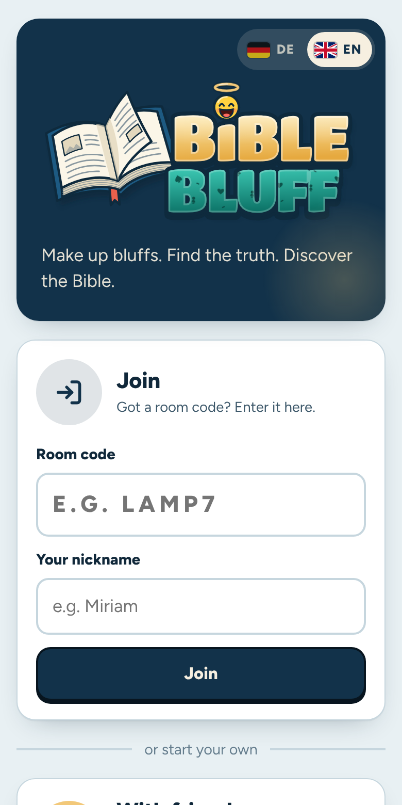 | 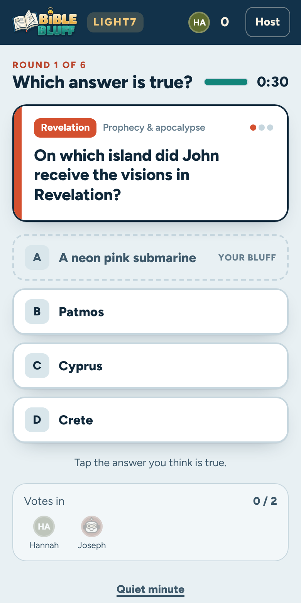 |

Oben rechts auf der Startseite schaltet die britische Flagge auf Englisch (britisches Englisch); voreingestellt ist Deutsch. Die Wahl gilt auf diesem Gerät, Links mit `?lang=en` stellen sie ebenfalls um.

- **Räume haben eine Sprache.** Wer auf Englisch eröffnet, bekommt einen englischen Raum: englischer Raumcode (`LAMP7`), englische Fragen, Spickzettel, Herzensrunde, Auszeichnungen, Entdeckungen und Wochenverse. Im Raum zeigen alle Handys und die Leinwand die Sprache der Partie, auch wenn ein Gerät auf Deutsch steht. Die offenen Räume auf der Startseite erscheinen nur in ihrer Sprache.
- **Link-Vorschau:** Einladungen in englische Räume tragen `?lang=en` und zeigen eine englische Vorschau (`og-invite-en.jpg`), ebenso `/?lang=en` und englische Entdeckungen-Seiten (`og-en.jpg`).
- **Fragen:** 88 ausgewählte Fragen und Lückentexte aus dem deutschen Pool (`src/server/en/questions.ts`, Spickzettel in `src/server/en/talk.ts`) mit denselben IDs – „Neues für alle“ kennt eine Frage darum in beiden Sprachen. Bluffs und Schlüsselwörter sind für Englisch neu gebaut, Bibelstellen stehen in englischer Zählung (Jona 2,1 → Jonah 1:17).
- **Bibeltext:** World English Bible, British Edition (gemeinfrei) – für die Wochenverse (`src/shared/verses-en.ts`), den Kalender und Zitate wie in der ruhigen Minute.
- **Oberfläche:** Der deutsche Text ist zugleich der Schlüssel. `t('Runde {n} von {total}', …)` holt die englische Fassung aus `src/shared/i18n-en.ts`; für Platzhalter, die Elemente sind (etwa ein fetter Raumcode), gibt es `tj`. Meldungen des Servers kommen über den Header `x-lang` in der Sprache der App. Ein Test prüft, dass jeder Text übersetzt ist, kein Eintrag verwaist und alle Platzhalter stimmen.
- **Noch deutsch:** die Freigabe-Seite `/admin`; frische Hausbluffs sammelt das Spiel vorerst nur aus deutschen Partien. Impressum und Datenschutz gibt es als Übersetzung, verbindlich ist die deutsche Fassung.

Neue Texte also im Code mit `t('…')` schreiben und die englische Fassung in `src/shared/i18n-en.ts` ergänzen – `npm test` meldet, was fehlt.

### Neues für alle

Bei einem Bluff-Spiel verdirbt eine bekannte Frage die Runde: Wer die Antwort noch weiß, tippt sofort richtig. Darum merkt sich jedes Handy, welche Fragen es schon aufgelöst gesehen hat (nur die Frage-IDs, nur auf dem Gerät), und meldet sie beim Eröffnen oder Beitreten. Der Server zählt pro Raum, wie viele Leute eine Frage kennen, und zieht zuerst Fragen, die niemand kennt, dann die, die am wenigsten Leute kennen. Die Lobby zeigt, wie viele Fragen „für alle neu“ sind.

### Frische Hausbluffs

Jede Frage hat drei vorbereitete Hausbluffs, die auch der Vorschlagsknopf liefert. Wer öfter spielt, erkennt sie irgendwann. Deshalb sammelt das Spiel nach jeder Partie Bluffs, die mindestens zwei Leute reingelegt oder zwei Herzen bekommen haben, als Kandidaten: ohne Namen, und ohne Bluffs, in denen ein Name aus dem Raum vorkommt.

Auf **`/admin` → Hausbluffs** prüfst du die Kandidaten, korrigierst bei Bedarf den Text und nimmst sie auf oder lehnst sie ab. Erst aufgenommene Bluffs ergänzen die Hausbluffs und Vorschläge ihrer Frage. Das Spiel lehnt ab, was zu nah an der richtigen Antwort liegt oder schon ein Hausbluff ist.

### Gespielte Nicknamen im Adminbereich

Unter **`/admin` → Nicknamen** steht eine durchsuchbare Liste der gespielten Spitznamen mit erstem und letztem Erfassungszeitpunkt (deutsche Ortszeit). Jeder menschliche Mitspieler wird beim Spielstart einmal pro Partie erfasst, ebenso spätere Beitritte. Bot, reine Spielleitungen und lediglich wartende Lobbygäste werden nicht gesammelt. Groß-/Kleinschreibung und gleichwertige Unicode-Schreibweisen werden zusammengeführt; ein Nickname ist ausdrücklich keine eindeutige Person.

Die separate Tabelle `played_nicknames` bleibt nach dem Aufräumen der Spielräume erhalten. Sie enthält keine Raumcodes, Spielzüge oder Sitzungskennungen. Suche, Blättern und Entfernen nutzen denselben `ADMIN_KEY` wie die Bluff-Freigabe; ohne gültigen Schlüssel ist auch die API gesperrt. Nach dem Entfernen wird der Eintrag nicht durch bloßes Neuladen derselben Partie wiederhergestellt. Eine neue Teilnahme kann ihn erneut erfassen.

Die Erfassung beginnt mit dieser Funktion. In noch laufenden Altpartien erfolgt sie beim nächsten gespeicherten Zustandswechsel; bereits gelöschte Räume sind nicht rekonstruierbar. Migration: `0005_played_nicknames.sql`. Falls sie in einer Vorschau oder beim Ausrollen noch fehlt, legt die D1-Anbindung die neue Tabelle selbst an. Raumzustand und Nicknamen werden gemeinsam in einer Transaktion gespeichert, damit fehlgeschlagene oder konkurrierende Spielstarts keine falschen Einträge hinterlassen.

Die Seite braucht einen Schlüssel: Lege im Cloudflare-Dashboard unter **Workers & Pages → bible-bluff → Settings → Variables and Secrets** ein Secret `ADMIN_KEY` an, am besten eine lange Zufallsfolge. Ohne diesen Schlüssel ist die Freigabe abgeschaltet. Lokal geht es mit `ADMIN_KEY=… npm start`.

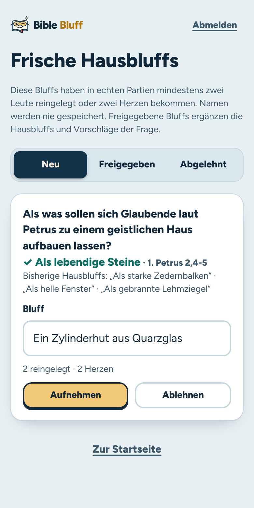

### Faire Runden

- **Versehentlich richtige Bluffs** werden abgelehnt („zu nah an der Wahrheit“). Jede Frage hat dafür hinterlegte Schlüsselwörter und Antwortvarianten, dazu kommt ein unscharfer Textvergleich. Zahlen werden dabei nicht verwechselt (400 ≠ 430).
- **Gleiche Bluffs** werden zusammengeführt, unabhängig von Groß- und Kleinschreibung, Füllwörtern, Wortreihenfolge und kleinen Tippfehlern. Fallen andere darauf herein, bekommen alle Urheber ihre Punkte.
- **Wenige Bluffs?** Dann füllt das Spiel mit vorbereiteten „Hausbluffs“ auf, damit immer mindestens vier Antworten zur Wahl stehen.
- **Geheimnisse bleiben auf dem Server.** Die richtige Antwort, die Urheber der Bluffs und die Stimmen gelangen erst mit der Aufdeckung zu den Handys. Die Fragen liegen nicht im Browser-Code.

### Für die Spielleitung

Das Menü „Leitung“ bietet:
- Pausieren und Fortsetzen (alle Zeitlimits stehen still)
- eine Phase vorzeitig beenden
- eine Frage tauschen oder die Aufdeckung beschleunigen
- den Raum für Neue sperren
- den Raum öffentlich auf der Startseite zeigen
- Teilnehmende entfernen
- die Spielleitung übergeben
- den Raum schließen

Die Spielleitung bleibt bei der Person, die den Raum eröffnet hat, auch wenn ihr Handy zwischendurch gesperrt ist oder sie kurz in eine andere App wechselt, etwa um den Code zu verschicken. Abgeben lässt sie sich nur bewusst über „Spielleitung übergeben“. Wer als Leitung das Gerät wechselt, gibt denselben Spitznamen wieder ein und leitet weiter. Die Punkte-Phase läuft nach 40 Sekunden von selbst weiter.

### Öffentliche Räume

Wer keine eigene Gruppe hat, kann trotzdem mitspielen: Die Leitung kann ihren Raum im Warteraum oder im Menü „Leitung“ öffentlich zeigen. Dann steht er auf der Startseite unter „Offene Räume“, und alle können mit einem Tipp beitreten, auch mitten in eine laufende Partie. Der Schalter ist zunächst immer aus.

- **Keine Namen auf der Startseite.** Die Liste zeigt nur Raumcode, Zahl der Personen, Stand der Partie und Schwierigkeit. Spitznamen und anderer Freitext erscheinen dort nie, damit niemand Unpassendes auf die Startseite bringen kann.
- **Nur Räume, in denen wirklich gespielt wird.** Gesperrte, volle, beendete und geschlossene Räume fehlen, ebenso Räume, in denen seit 15 Minuten niemand mehr verbunden war. Die Frist ist bewusst großzügig: Ein Handy im Hintergrund oder mit gesperrtem Bildschirm fragt nicht nach, und die Leitung soll trotzdem in Ruhe auf Mitspielende warten können.
- **Transparent für alle im Raum.** Mitspielende sehen im Warteraum, dass ihr Raum öffentlich ist.
- **Bescheid für die Leitung.** Tritt jemand einem öffentlichen Raum bei, vibriert das Handy der Leitung kurz und zeigt etwa „Hanna ist beigetreten“. Auf dem iPhone, das Webseiten keine Vibration erlaubt, erklingt stattdessen ein leiser Zweiklang. Damit das auch beim Warten klappt, bleibt der Bildschirm der Leitung an, solange ihr Raum öffentlich ist. Ist das Handy gesperrt oder der Raum im Hintergrund, kann eine Webseite weder vibrieren noch nachfragen; die Meldung kommt dann beim Zurückkehren.
- **Sparsam.** Die Startseite fragt alle 10 Sekunden nach, solange sie sichtbar ist, und der Worker hält die Liste 4 Sekunden vor. Die Liste erscheint nur, wenn es gerade offene Räume gibt.

### Allein gegen Jakob

Wer gerade keine Gruppe hat, startet mit **„Jetzt sofort spielen“** direkt vier leichte Runden in einem eigenen, privaten Raum mit Jakob. Die Startseite stellt Jakob als virtuellen Mitspieler vor und lädt auch Menschen ohne viel Bibelwissen ein. Die Probefrage zur Münze im Fischmaul (Matthäus 17,24–27) zeigt den Unterschied zwischen Bluff und Wahrheit. Unter **„Spiel anpassen →“** (Seite `/jakob`) lassen sich Runden und Schwierigkeit selbst wählen; dort sind 6 gemischte Runden vorgeschlagen. Alte Links zu `/joseph` funktionieren weiterhin. Die Person leitet den Raum und kann auch Freunde einladen.

- **Bluffen:** Jakob schreibt nach ein paar Sekunden Bedenkzeit einen Hausbluff zur Frage. Sobald alle Menschen abgegeben haben, zieht er sofort nach, damit niemand auf ihn warten muss.
- **Raten:** Jakob findet die Wahrheit in etwa 45 Prozent der Runden. Seinen eigenen Bluff wählt er nie.
- **Herzen:** Nach der Auflösung verteilt er ein Herz an einen Bluff der Menschen.
- **Nur Mitspieler:** Jakob ist immer verbunden, kann aber nie die Leitung übernehmen. Gehen alle Menschen, schließt der Raum. Wer „Jakob“ heißen will, muss sich einen anderen Namen suchen.
- **Ohne laufenden Prozess:** Jakob zieht wie alles andere „im Vorbeigehen“, wenn ein Handy nachfragt.

### Weitersagen

Bible Bluff verbreitet sich über Gruppen, die es gespielt haben. Darum hilft das Spiel beim Weitersagen:

- **Link-Vorschau.** Wer biblebluff.de in WhatsApp, Signal oder Telegram teilt, bekommt eine Vorschau mit Logo, kurzem Satz und großem Bild (`og.jpg`). Einladungslinks in einen Raum (`/r/LAMPE7`) zeigen stattdessen „Du bist eingeladen – Raum LAMPE7“ mit eigenem Bild (`og-invite.jpg`). Dafür laufen diese Links zuerst durch den Worker (`run_worker_first` in `wrangler.toml`). Er liefert dieselbe App aus und tauscht nur Titel, Text und Bild der Vorschau aus (`src/server/preview.ts`). Auf Testadressen (Vorschau je Pull-Request, workers.dev) holt auch die Startseite ihr Vorschaubild von dort statt von biblebluff.de; auf biblebluff.de selbst bleibt sie rein statisch. Der lokale Server macht es genauso. Suchmaschinen bleiben laut `robots.txt` weiter draußen; die Vorschau-Dienste von Messengern und sozialen Netzwerken dürfen Einladungslinks lesen.
- **Einladung am Spielende.** Mitspielende sehen nach der Partie die Karte „Leite selbst eine Runde“ mit „Eigenen Raum eröffnen“ und „Link an deine Gruppe schicken“. Nach einer Partie gegen Jakob heißt die Karte „Jetzt mit Freunden spielen“; „Nochmal gegen Jakob“ geht weiterhin. Die Leitung einer Gruppe und die Leinwand sehen keine solche Karte.

### Verbindungsabbrüche

Jedes Handy merkt sich seine Sitzung. Neu laden, kurz das WLAN verlieren oder den Bildschirm sperren kostet nichts. Wer das Gerät oder den Browser wechselt, gibt einfach denselben Spitznamen wieder ein und steigt am alten Platz wieder ein, solange das alte Gerät nicht mehr verbunden ist. Während der Partie bleibt der Bildschirm wach, sofern der Browser das unterstützt. Ein fertiger, aber noch nicht abgeschickter Bluff wird kurz vor Ablauf der Zeit automatisch abgegeben.

## Loslegen

Voraussetzung ist Node.js 20 oder neuer.

```bash
npm install
npm run dev          # http://localhost:5173 – App mit eingebauter API (Räume im Arbeitsspeicher)
```

### Spieleabend ohne Cloud (eigenes WLAN)

```bash
npm run build
npm start            # zeigt die Adresse im WLAN an, z. B. http://192.168.0.23:8787
```

Alle Handys im selben WLAN öffnen diese Adresse. Am besten eröffnet die Spielleitung den Raum über die WLAN-Adresse, dann zeigt auch der QR-Code dorthin. Die Räume liegen im Arbeitsspeicher und verschwinden beim Beenden.

### Veröffentlichen auf Cloudflare (Workers + D1)

Die D1-Datenbank `bible-bluff` (Region Westeuropa) ist angelegt, das Schema ist eingespielt, und ihre ID steht in `wrangler.toml`. `npx wrangler deploy` baut die App selbst (`[build]` in `wrangler.toml`) und veröffentlicht Worker und Assets.

**Empfohlen: automatisch bei jedem Push auf `main` (Workers Builds).** Im Cloudflare-Dashboard unter **Workers & Pages → bible-bluff → Settings → Builds → Connect** das GitHub-Repository `roruffm/bible-bluff` mit dem Branch `main` verbinden. Die Voreinstellungen passen: kein Build-Befehl nötig, Deploy-Befehl `npx wrangler deploy`. Danach löst jeder Merge in `main` die Veröffentlichung aus.

**Oder von Hand:**

```bash
npx wrangler login
npm run db:migrate:remote                 # neue Migrationen einspielen (aktuell bis 0004_listed_rooms)
npm run deploy                            # baut die App und veröffentlicht Worker + Assets
```

**Vorschauen je Pull-Request:** Workers Builds baut zu jedem Pull-Request eine Vorschau mit eigener URL (`wrangler preview`). Vorschauen nutzen eine eigene Datenbank `bible-bluff-preview` (Block `previews` in `wrangler.toml`), damit Tests nie Räume der Produktion berühren. Neue Migrationen müssen deshalb in beide Datenbanken: `npm run db:migrate:remote` für die Produktion und `npx wrangler d1 execute bible-bluff-preview --remote --file migrations/<datei>.sql` für die Vorschau.

Die Tabellen `recaps` (Entdeckungen-Seiten) und `bluff_pool` (frische Hausbluffs) sowie den Index für öffentliche Räume legt der Worker beim ersten Bedarf auch selbst an. Fehlt eine Migration in einer Datenbank, funktioniert trotzdem alles.

Für ein anderes Cloudflare-Konto zuerst `npx wrangler d1 create bible-bluff` und `npx wrangler d1 create bible-bluff-preview` ausführen und beide `database_id`-Werte in `wrangler.toml` eintragen.

Lokal lässt sich der echte Worker mit D1 so testen: `npm run dev:cf` (Port 8787).

## Technik

```
Handys / Leinwand ──(etwa jede Sekunde: GET /api/rooms/CODE)──▶ Cloudflare Worker ──▶ D1
                  ◀── persönliche, gefilterte Sicht ──────────┘   rooms (JSON + Version)
                  ──(POST /api/rooms/CODE/action)─────────────▶   presence (zuletzt gesehen)
Endstand          ──(POST /api/rooms/CODE/recap)──────────────▶   recaps (Entdeckungen-Seiten)
Seite /e/ID       ──(GET /api/recaps/ID)──────────────────────▶
Wochenvers        ──(GET /api/kalender?vers=…&ab=…&zeit=…)───▶   (nichts gespeichert, nur Kalenderdatei)
Startseite        ──(GET /api/rooms, offene Räume)────────────▶   rooms (nur öffentlich gezeigte)
Freigabe /admin   ──(GET/POST /api/admin/bluffs, ADMIN_KEY)───▶   bluff_pool (Kandidaten, freigegebene Bluffs)
```

- **Server entscheidet alles.** Zeitlimits, Phasenwechsel, Duplikat-Erkennung und Punkte werden zentral berechnet. Phasen schalten „im Vorbeigehen“ weiter, also bei der nächsten Anfrage nach Ablauf der Frist oder sobald alle Verbundenen abgegeben haben. So braucht es weder Cron noch Dauerprozess.
- **Optimistische Sperre.** Der Raumzustand liegt als JSON mit Versionsnummer in D1. Ein Update gilt nur, wenn niemand dazwischen geschrieben hat; sonst wird neu gelesen und wiederholt. Getestet ist das mit zwölf gleichzeitigen Abgaben gegen lokale D1.
- **Synchrone Aufdeckung.** Der Server legt Ablauf und Startzeit fest. Jedes Gerät gleicht seine Uhr mit dem Server ab und rechnet den aktuellen Schritt selbst aus. Darum stehen alle Handys im selben Moment beim selben Bluff.
- **Präsenz** wird gedrosselt in einer eigenen Tabelle festgehalten (höchstens alle 5 s pro Gerät). Sie bestimmt, auf wen gewartet wird.
- **Spiel-Engine als reine Funktionen** (`src/server/engine.ts`): Zeit, Zufall und Präsenz kommen von außen. Das macht sie vollständig testbar. Dieselbe API läuft im Worker, im Vite-Dev-Server und im lokalen Node-Server.
- **Frontend:** Preact und Vite, etwa 25 kB JavaScript (gzip). Die Schrift Figtree ist selbst gehostet, es gibt keine externen Dienste und keine Cookies. Das Design ist an die Lernblätter angelehnt: Papier, Dunkelbraun, Gold und die Farben der Buchgruppen.

### Kosten und Grenzen

Eine Partie mit 12 Handys erzeugt rund 40 000 Anfragen pro Stunde (in der Lobby und während der Aufdeckung weniger). Der kostenlose Workers-Tarif erlaubt 100 000 Anfragen pro Tag, also gut zwei Stunden Spiel mit voller Besetzung. Für regelmäßige Spieleabende empfiehlt sich Workers Paid (5 $/Monat, 10 Mio. Anfragen) oder der lokale Server. Die Preise bitte vor der Entscheidung in der aktuellen Cloudflare-Preisliste prüfen. Als nächster Ausbauschritt bieten sich Durable Objects mit WebSockets an: Sie ersetzen das Abfragen und senken die Last deutlich.

Räume werden 24 Stunden nach der letzten Änderung gelöscht. Entdeckungen-Seiten bleiben dauerhaft; jede ist nur wenige Kilobyte groß.

### Farben

Jede Person wählt auf der Startseite (unter „Farben“ zum Aufklappen) oder im Menü ihr eigenes Farbkonzept. Die Wahl gilt nur auf diesem Gerät und bleibt gespeichert. Wer nichts wählt, sieht See Genezareth.

| Farbkonzept | Wirkung |
| --- | --- |
| See Genezareth (Standard) | Tiefes Blau, Türkis und Sand. |
| Lernblatt | Warmes Papier, Dunkelbraun und Gold wie die Lernblätter. Folgt Hell und Dunkel des Geräts. |
| Nachtquiz | Dunkel mit Neonfarben wie in einer Quizshow. Am stärksten auf dem Beamer im abgedunkelten Raum. |
| Spieltisch | Filzgrün, Kartenrot und Chipgold auf hellem Leinen. |
| Comic | Sonnengelb, Schwarz und Pink mit harten Schatten. |
| Klar | Viel Weiß, Indigo und Koralle. Schlicht und gut lesbar. |

Der Link „Leinwand-Ansicht öffnen“ nimmt das Farbkonzept der Spielleitung mit (`/tv/RAUMCODE?farbe=nacht`).

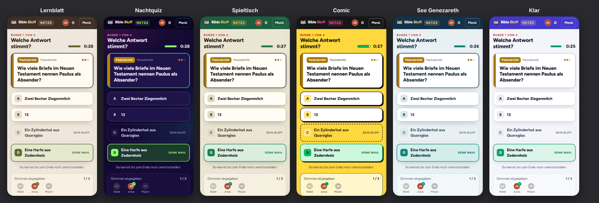

Technisch setzt jedes Konzept nur CSS-Variablen (`html[data-theme]` am Ende von `src/client/styles.css`). Lernblatt steht direkt in `:root` und braucht kein `data-theme`. Namen, Vorschaufarben und der Standard stehen in `src/client/lib/theme.ts`.

## Logo

Das Logo zeigt eine aufgeschlagene Bibel, daneben „BIBLE“ mit einem lachenden Smiley samt Heiligenschein als i-Punkt und „BLUFF“ voller Spielkartenzeichen. In der App ist es die Komponente `LogoArt` (ein SVG): Die Buchstaben sind Umrisse der Schrift Titan One (SIL Open Font License), es braucht also keine Webschrift. Alle Farben kommen aus den Variablen `--logo-*`, die jedes Farbkonzept setzt – „BLUFF“ ist zum Beispiel in See Genezareth türkis, im Nachtquiz pink und im Comic blau; im großen Logo schwebt der Heiligenschein ein wenig.

`src/client/public/logo.svg` ist das Logo in den Lernblatt-Farben zum Weitergeben. Favicon und Homescreen-Icons entstehen aus der Bildmarke `src/client/public/logo-mark.svg` (Buch mit Heiligenschein-Smiley) mit `node scripts/render-icons.mjs`: `favicon.ico` und `apple-touch-icon.png` im Wurzelverzeichnis, wo viele Apps von sich aus nachsehen, dazu `icons/bible-bluff*.svg/png` für Browser und Manifest. Die Namen sind seit dem Logo-Wechsel neu, denn Messenger und Browser merken sich Symbole unter ihrer Adresse und zeigten unter den alten Namen noch das frühere Logo mit der Bluffmaske. Die alten Adressen leiten per `public/_redirects` dauerhaft um. Bei einem künftigen Logo-Wechsel die Namen wieder ändern.

Die Vorschaubilder für geteilte Links (`og.jpg` und `og-invite.jpg`, auf Englisch `og-en.jpg` und `og-invite-en.jpg`, je 1200 × 630 Pixel) entstehen mit `npm run build && node scripts/render-og.mjs` aus der gebauten App, mit dem Logo in See Genezareth; mit Dateinamen dahinter nur die genannten. Alles Wichtige steht in der Mitte, weil manche Apps nur einen quadratischen Ausschnitt zeigen.

## Impressum und Datenschutz

Unter `/impressum` und `/datenschutz` stehen Impressum und Datenschutzerklärung. Links darauf gibt es auf der Startseite, beim Raum-Eröffnen, beim Beitreten, auf den Entdeckungen-Seiten und im Menü eines Raums (dort in einem neuen Tab, damit niemand aus der Partie fällt). Name, Anschrift und E-Mail stehen an einer Stelle in `src/client/screens/Legal.tsx` (`ANBIETER`). Ändert sich etwas daran, was das Spiel speichert, gehört die Datenschutzerklärung in derselben Datei mit angepasst – und die englische Übersetzung in `src/client/screens/LegalEn.tsx`.

## Fragen ergänzen

Die Fragen stehen in `src/server/questions.ts`. Jede Frage hat folgende Felder:

```ts
{
  id: '2tim-mantel',
  book: '2. Timotheus',
  group: 'pastoral',                 // Farbe der Buchgruppe; 'at' für das Alte Testament
  difficulty: 2,                     // 1 leicht · 2 mittel · 3 schwer
  prompt: 'Was sollte Timotheus Paulus mitbringen?',
  answer: 'Einen Mantel, Bücher und Pergamente',     // im Stil eines Bluffs: kurz, ohne Klammern
  accept: [['mantel'], ['pergament'], ['*buecher']], // Schlüsselwörter für „zu nah an der Wahrheit“
  bluffs: ['Brot, Öl und neue Sandalen', /* … */],    // Vorschläge und Hausbluffs
  ref: '2. Timotheus 4,13',
  discovery: 'Auch Paulus brauchte warme Kleidung und Lesestoff. …',
}
```

Lückentexte stehen in `src/server/lueckentext.ts` und haben zusätzlich `kind: 'gap'`. Ihr `prompt` ist ein Satz mit genau einer Lücke `___`; `answer`, `variants` und `bluffs` sind Satzteile, die grammatisch in die Lücke passen und mitten im Satz richtig geschrieben sind („dem Kieferknochen eines Esels“). Die Kategorie ergibt sich aus `group`.

Schlüsselwörter werden ohne Umlaute geschrieben (`ae`, `oe`, `ue`, `ss`). Ein Wort ohne Zeichen muss am Wortanfang passen, `*wort` darf irgendwo im Wort stehen, `=wort` muss genau so lauten. Mehrere Wörter in einer Gruppe müssen alle vorkommen. Die Tests prüfen jede Frage automatisch: Die Antwort selbst muss erkannt werden, die vorbereiteten Bluffs dürfen nicht anschlagen.

## Tests

```bash
npm run typecheck
npm test             # Engine, Textvergleich, Fragenpool, Gesprächsstoff, API, Freigabe, Link-Vorschau, Herzensrunde, Wochenverse, englische Fassung (Vitest)
npm run test:e2e     # komplette Partien mit mehreren Browsern (Playwright)
```

## Projektstruktur

```
src/
  shared/      Typen, Regeln und Übersetzungen (i18n-en.ts), die Server und Browser teilen
  server/      Engine, Fragenpool, Textvergleich, API, D1-/Speicher-Anbindung (englischer Pool in server/en/)
  worker.ts    Cloudflare-Worker-Einstieg (API, Link-Vorschau für Einladungen)
  client/      Preact-App (Startseite, Lobby, Phasen, Aufdeckung, Leinwand)
migrations/    D1-Schema
scripts/       lokaler Node-Server, App-Icons und Vorschaubilder
tests/ e2e/    Unit- und End-to-End-Tests
```

### Themenpakete und Blufftraining

Beim Eröffnen und in der Lobby gibt es vier Themenpakete: **Kaum zu glauben**, **Tiere der Bibel**, **Essen und Wunder** und **Für Bibelneulinge**. Die Auswahl zeigt die Anzahl zur gewählten Rundenart; Bibelbereiche lassen sich weiter eingrenzen. Die Auswahl wirkt serverseitig auch auf Ersatzfragen und „Neues für alle“. Alte Räume spielen unverändert mit ihren bisherigen Kategorien. Der englische Pool enthält nun 88 Fragen und Lückentexte samt Gesprächsimpulsen.

Die Probefrage hat eine vierte, selbst geschriebene Antwort. Die Lernhilfe gibt Beispiele, erkennt doppelte Antworten und warnt vor einem Bluff, der zu nah an der echten Antwort liegt. Sie verspricht keine automatische Bewertung der Überzeugungskraft.

Nach jeder Runde stehen richtige Antwort, eigener Punktegewinn und „Nächste Runde“ oben. Entdeckung, Punktestand, Gesprächsimpulse und Extras sind auf dem Handy zunächst zugeklappt; auf der Leinwand bleiben richtige Antwort und Punktestand sichtbar. Entdeckung und jeweils zwei Bluffs wechseln in einer eigenen Karte; die Anzeige lässt sich anhalten und manuell weiterblättern.

Beim **Besten Bluff des Abends** erstellt ein Klick eine Story-Karte in 1080 × 1920 mit Frage, Bluff, tatsächlicher Zahl der hereingefallenen Personen, Original-Logo und biblebluff.de. Namen sind standardmäßig aus und können ergänzt werden. Die Karte entsteht lokal, lässt sich über das Handy teilen oder als PNG herunterladen. Bei früher abgeschlossenen Runden ohne gespeicherte Stimmenzahl zeigt sie die gesicherten Herzen statt einer erfundenen Zahl.


### Raum, Lobby und Leinwand

Beim Eröffnen einer Gruppenpartie stehen Spitzname, Rundenzahl und Themenpaket direkt bereit. „Weitere Einstellungen“ öffnet Leitung/Mitspielen, Herzensrunde, Rundenart, Bibelbereiche, Schwierigkeit und Zeiten. Die Lobby fasst die aktive Partie zusammen; „Einstellungen ändern“ öffnet die vorhandenen Optionen. Der Startknopf bleibt erreichbar, Spielregeln sind aufklappbar.

Die Leinwand zeigt bis zu zwölf Personen ohne lange Seitenstapel. Am Endstand wechseln Platzierungen, Auszeichnungen und jeweils zwei Entdeckungen automatisch; der QR-Code zur Entdeckungen-Seite bleibt sichtbar. Herzensantworten erscheinen ohne Namen in Zweiergruppen. „Anzeige anhalten“ hält nur den Ansichtswechsel an; die Spielleitung pausiert die Partie weiterhin über ihr Menü.

### Entwürfe und fehlgeschlagene Aktionen

Ungesendete Bluff-Entwürfe liegen im `sessionStorage` des aktuellen Browser-Tabs, getrennt nach Raum, Person und stabiler Rundenkennung. Neuladen und Pausen erhalten sie. Erfolgreiche Abgabe, eine neue Frage und das Rundenende entfernen den alten Entwurf. Bereits vom Server bestätigte Texte werden auch nach einer verlorenen HTTP-Antwort als abgeschickt erkannt.

Aktionen ohne eigenen Fehlerbereich zeigen bei Fehlern einen bleibenden Hinweis mit „Erneut versuchen“. Vor der Wiederholung wird der Serverstand abgefragt. Hat sich die Phase bereits geändert, wird die alte Aktion nicht erneut gesendet. Formulare und Leitungsmenü behalten ihre Rückmeldungen direkt am Eingabebereich.
